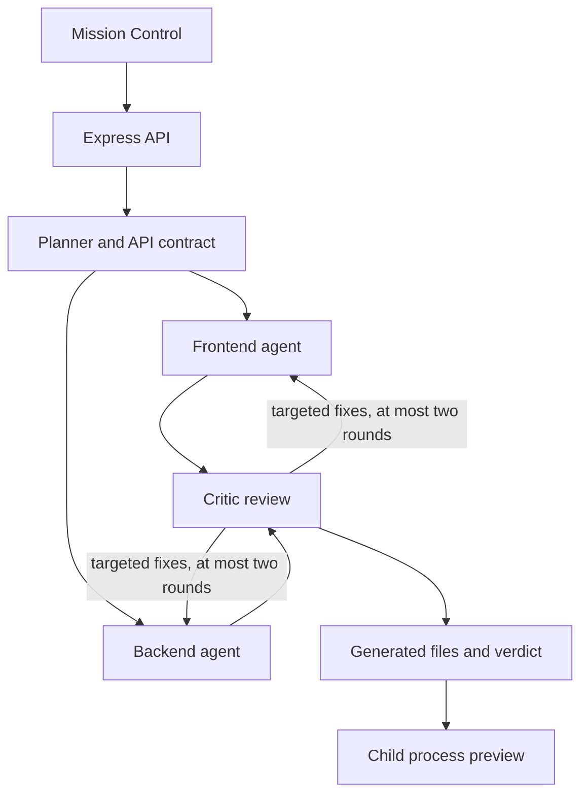

# Architecture and contribution map

DevSwarm is a single Node.js ESM process serving a framework-free UI. It sends
model requests to Hugging Face and optionally exports telemetry to SigNoz.

The generation path adds deterministic structural checks to the critic's review.
It persists artifacts even when review still fails after the retry budget.
Refinement scopes changes to selected agents, runs one critic review, overwrites
the app files and appends review history. It currently does not repeat the
generation structural check or roll back a failed refinement.

## Where to make changes

| Area | Files | Contract to preserve |
| --- | --- | --- |
| API and SSE | `src/server.js`, `src/bus.js` | JSON API responses, event lifecycle and listener cleanup |
| Generation/refinement | `src/orchestrator.js` | Shared plan, review loop, saved artifact layout and trace attributes |
| Model transport | `src/llm.js` | Streaming HF responses, provider variants, fallback and output validation |
| Model configuration | `src/models.js` | Role routing, completion caps and TTL-bound promotion |
| Agent behavior | `src/agents/`, `swarm/` | Fenced output, API/field contracts, focused critic feedback |
| Preview lifecycle | `src/apps.js` | One child per app, readiness, idle cleanup and restart after refine |
| Telemetry | `src/telemetry.js`, `observability/` | Trace, metric and log names used by dashboards and Doctor |
| UI | `ui/index.html`, `ui/app.html` | Plain HTML/CSS/JS, keyboard access, responsive states and SSE feed |

## Artifacts

`generated/<id>/` contains `public/index.html`, `server.js`, `plan.json`,
`review.json`, `otel.mjs`, `package.json`, `README.md` and
`signoz-dashboard.json`. Generated output is ignored by Git. Inside this repo,
child servers resolve dependencies through the parent's `node_modules`.
Standalone exported apps need their own installation.

## Telemetry and events

`otel-swarm` owns the tracing context and its event bus. `src/telemetry.js`
forwards events to DevSwarm's bus and adds local metrics and logs. The UI receives
the process-wide bus at `/api/events`. Events are not isolated by user, and some
generation-stage events do not yet have a stable run identifier.

Doctor reads trace-derived health through ClickHouse, calls its model, and
applies allowed routing actions. Promotion state is in memory and resets on
server restart. Trace queries assume the SigNoz schema documented in the
observability pack.

## Boundaries and limitations

The API is unauthenticated. Previews share the host user's privileges and the
DevSwarm browser origin. Environment filtering does not provide filesystem,
network or browser isolation. Model verdicts are advisory. Read [SECURITY.md](../SECURITY.md)
before live usage, and see the [roadmap](../ROADMAP.md) for contributor tasks.
